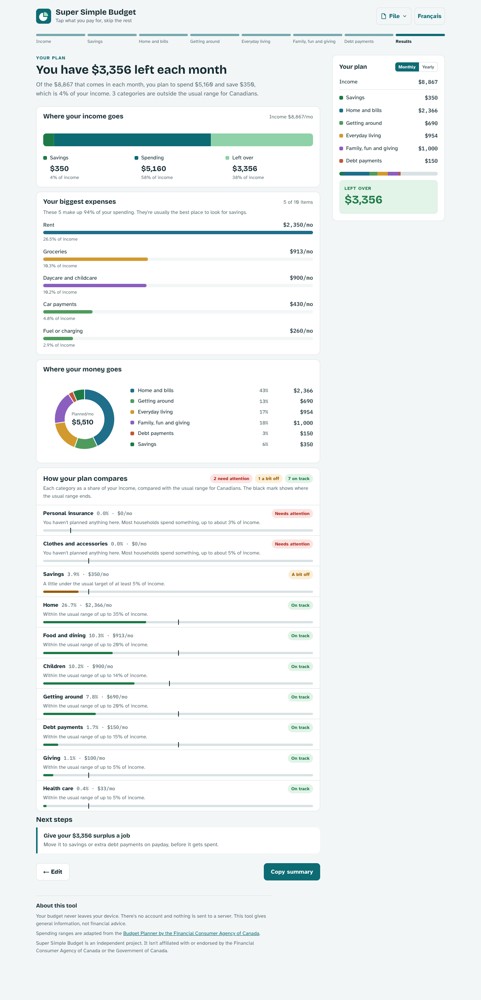
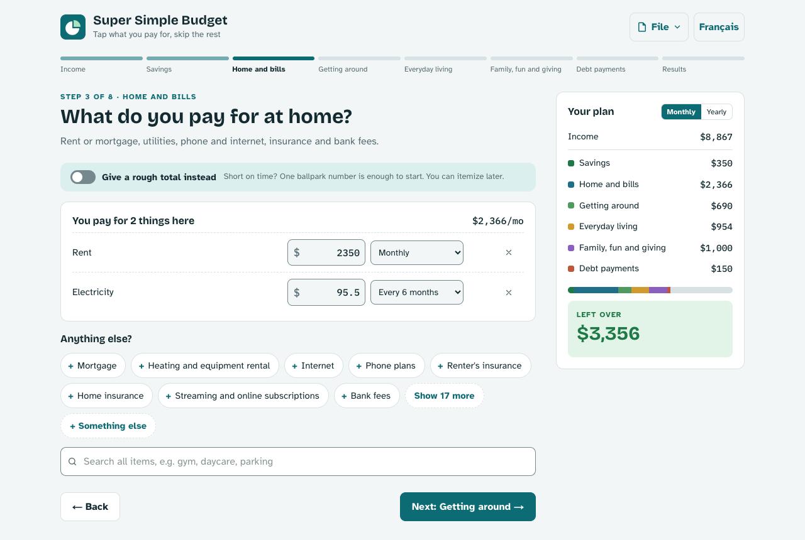
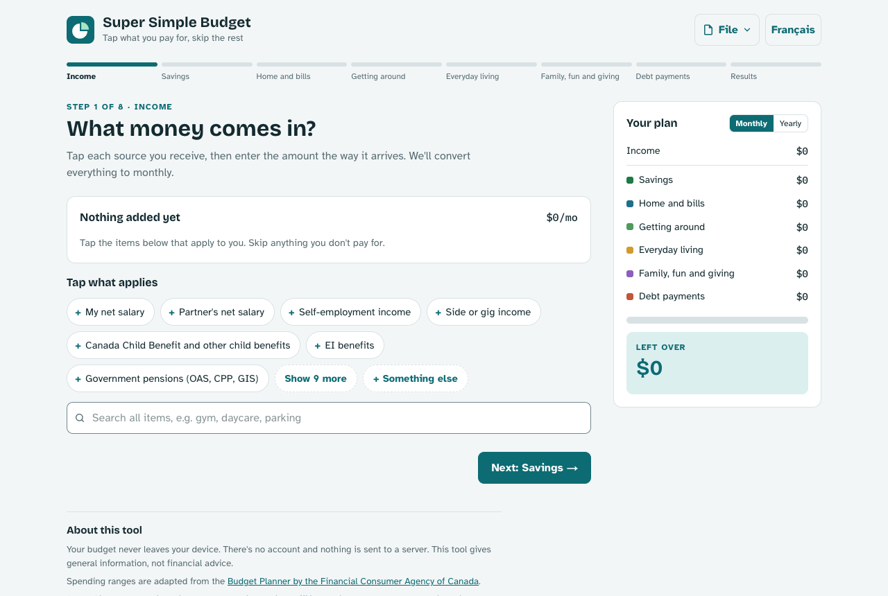
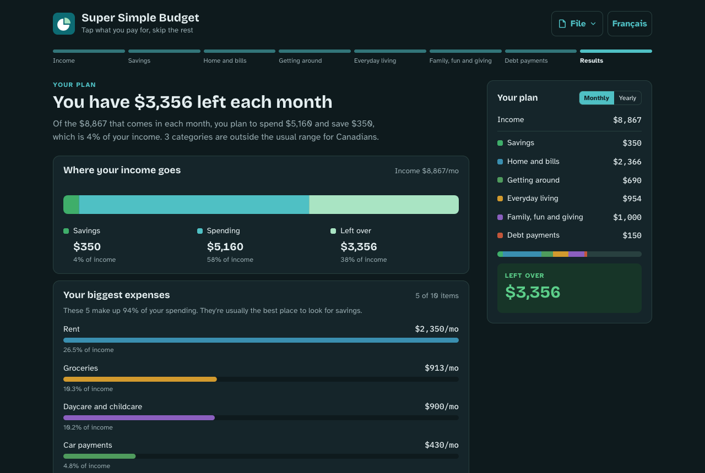
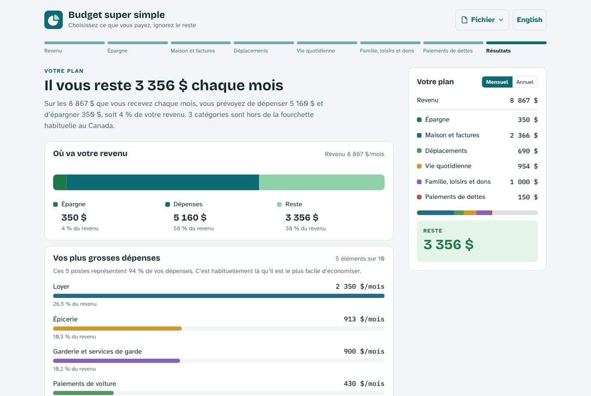
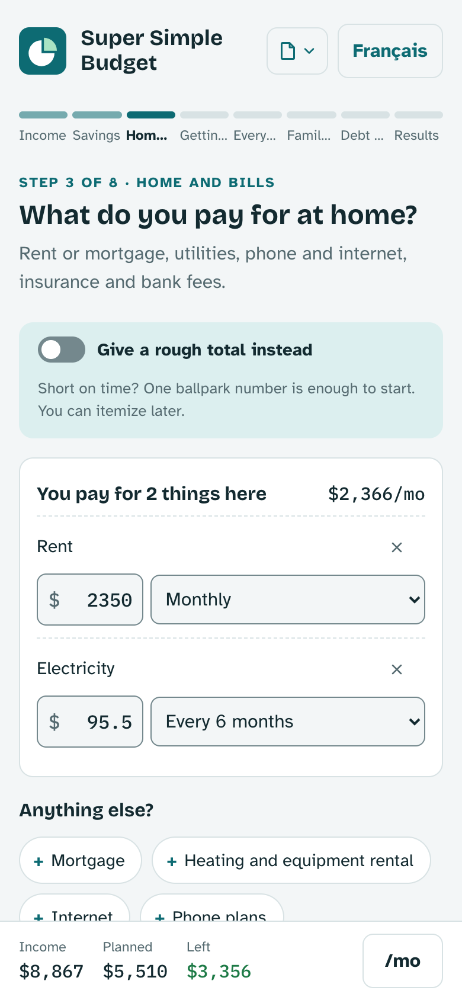

# Super Simple Budget

A free, private, bilingual (English / French, Canada) monthly budget planner. Tap the things you pay for, enter each amount the way it arrives (weekly, every two weeks, yearly…) and get a monthly plan compared with usual Canadian spending ranges.

No sign-up and no server: the budget never leaves your browser.



## Features

- **Tap, don't type**: pick items from chips and type only the amounts. Search covers the whole catalog, and anything missing can be added as a custom item.
- **Any frequency**: daily, weekly, every two weeks, twice a month, monthly, quarterly, every six months or yearly. Everything is converted to a monthly (or yearly) plan.
- **One question per screen**: a 7-step wizard (income, savings, then five spending categories) with a running tally, then a results page.
- **Rough totals**: on categories where itemising is tedious, one ballpark number is enough.
- **Results that explain themselves**: where the income goes, the biggest expenses, the spending split, how each category compares with the usual Canadian range, and next steps.
- **Private**: no accounts and no server. The budget lives in the browser's `localStorage`. Save it as a `.json` file to keep or move it, export a `.csv` for a spreadsheet, or copy a plain-text summary.
- **Accessible**: WCAG 2.2 AA, built for keyboard and screen readers, works one-handed on a phone, and has light and dark themes.

## Screenshots

| Pick what you pay for | Start from an empty plan |
| --- | --- |
|  |  |
| **Dark theme** | **En français** |
|  |  |

<p align="center">
  
</p>

## How it works

1. **Income**: what comes in, as it arrives (for example, net pay every two weeks).
2. **Savings**: what you set aside.
3. **Spending**: home and bills, getting around, everyday living, family, fun and giving, and debt payments. Skip anything that doesn't apply.
4. **Results**: the monthly balance and a comparison with spending ranges adapted from the Financial Consumer Agency of Canada's [Budget Planner](https://itools-ioutils.fcac-acfc.gc.ca/BP-PB/budget-planner).

Steps can be visited in any order from the progress bar, and the tally switches between monthly and yearly amounts at any time.

## Privacy

Budget data is stored only in your browser and in the files you choose to save. The site uses Vercel Web Analytics for anonymous page views, which never include budget data. Clearing the budget (File → Clear budget) removes it from the browser.

## Tech stack

Next.js 16 (App Router, Cache Components, React Compiler) · React 19 · TypeScript (strict) · Redux Toolkit · Tailwind CSS v4 · Recharts (results only, code-split) · Jest, React Testing Library and jest-axe.

Each locale (`/en`, `/fr`) is one statically prerendered page. The wizard step is app state, not a URL.

## Getting started

Requires Node.js 20.9+ and pnpm (the version is pinned in `package.json`).

```sh
pnpm install
pnpm dev            # http://localhost:3000
```

Copy `.env.example` to `.env.local` and set `NEXT_PUBLIC_SITE_URL` to the public origin. Canonical URLs, Open Graph, the sitemap and robots use it. It falls back to `http://localhost:3000`.

### Scripts

| Command | What it does |
| --- | --- |
| `pnpm dev` | Development server |
| `pnpm build` / `pnpm start` | Production build / serve it |
| `pnpm lint` | ESLint |
| `pnpm typecheck` | `tsc --noEmit` |
| `pnpm test` | Jest (`pnpm test path/or/pattern`, `pnpm test -t "name"`) |
| `pnpm test:watch` / `pnpm test:coverage` | Watch mode / coverage report |
| `node scripts/bundleSize.mjs` | Gzip sizes of first-load JS and the results chunk vs the budgets (after `pnpm build`) |
| `node scripts/leakCheck.mjs [url] [rounds]` | Memory check in headless Chrome against a running build |

## Project layout

```
app/[lang]/        root layout (metadata, fonts, providers) and the page shell
domain/            pure budget logic: catalog, frequencies, totals, rules, results
features/          app, budget, wizard, tally, results, files, notices, seo
components/ui/     stateless UI primitives
store/             Redux store, typed hooks, localStorage persistence
i18n/              typed en/fr dictionaries, t() and plural()
lib/               small helpers (formatting, parsing, CSV, downloads…)
docs/              spec, build plan, audits and screenshots
```

## Contributing

Issues and pull requests are welcome. Before opening a pull request, make sure `pnpm lint`, `pnpm typecheck`, `pnpm test` and `pnpm build` all pass. Tests sit next to the code as `*.test.ts(x)`. New copy needs both an English and a French entry: the dictionaries are type-checked for key parity.

## Documentation

- [`docs/SPEC.md`](docs/SPEC.md): requirements, architecture and data formats
- [`docs/PLAN.md`](docs/PLAN.md): the step-by-step build plan
- [`docs/audit.md`](docs/audit.md): accessibility, performance and memory audit
- [`docs/a11y-checklist.md`](docs/a11y-checklist.md): manual screen-reader checklist for each release
- [`docs/reference/artifact.html`](docs/reference/artifact.html): the frozen prototype (design, copy and catalog source)

## Disclaimer

Spending ranges are adapted from the Financial Consumer Agency of Canada's Budget Planner. This project is not affiliated with or endorsed by the FCAC or the Government of Canada, and it gives general information, not financial advice.

## License

[MIT](LICENSE)
